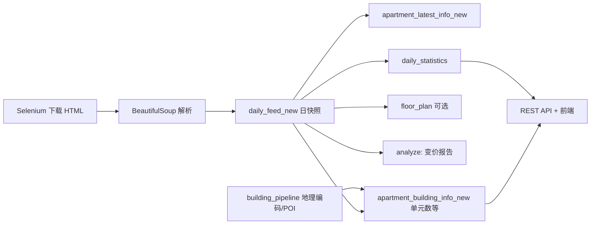

# Apartment 项目归档说明

> 归档日期：2025-10-31  
> 用途：整体重构前的现状记录（本仓库 + 共用 PostgreSQL 库 + 关联 Django API 工程）

---

## 1. 项目是什么

这是一个**租房挂牌数据采集与分析**系统：每天从各公寓官网抓取 availability 页面 HTML，解析成结构化房源记录，写入 PostgreSQL，并做日环比分析（新上架、下架、变价）。后期在 `Django_projects/apartment` 中扩展了 REST API、POI 评分、通勤时间、户型图与 Admin 能力；**本目录（`~/apartment`）主要是较早的数据管道子集**。

**业务目标（已实现或部分实现）：**

- 跟踪多栋/多运营商公寓的在售单元、租金、OP/免租等促销信息
- 保留按日的历史快照（`daily_feed_new`）
- 维护「当前最新状态」（`apartment_latest_info_new`）与楼栋元数据（`apartment_building_info_new`）
- 控制台输出日变更报告；API 侧供前端（CORS 预留 `http://localhost:3000`）查询统计、比价、通勤等

---

## 2. 本仓库（`~/apartment`）能做什么

### 2.1 入口

| 文件 | 作用 |
|------|------|
| `pipeline.py` | 按固定日期串行跑全流程（日期写死在文件内，如 `2024-12-25`） |
| `manage.py` | Django 4.1 壳工程；**未注册业务 App**，仅默认 admin |
| `apartment/settings.py` | PostgreSQL 连接、`django-cors-headers` 配置 |

### 2.2 流水线四步（`pipeline_steps/`）

```
download_htmls → daily_feed_pipeline → data_integrity_check → analyze_db
```

| 步骤 | 模块 | 能力 |
|------|------|------|
| 1. 下载 | `download_htmls.py` | `undetected_chromedriver` + Selenium 打开各站 availability，保存 `{date}/*.html`；Jackson Park / Avalon 需额外点击加载 |
| 2. 入库 | `daily_feed_pipeline.py` | 调用 `daily_feed_parse_codes/*` 解析 HTML → 写库并 upsert 衍生表 |
| 3. 校验 | `data_integrity_check.py` | 检查当日 `daily_feed` 关键字段非空；对比 `apartment_latest_info` 户型字段是否异常变化 |
| 4. 分析 | `analyze_db.py` | 与**上一有效抓取日**对比：新上架、下架、变价（仅 `print`，不写统计表） |

### 2.3 本仓库覆盖的公寓源（13 组解析器）

解析逻辑在 `daily_feed_parse_codes/`，与 `download_htmls.py` 中的 URL 一一对应：

| 解析模块 | 楼盘/来源 | 区域（解析结果中的 neighborhood） |
|----------|-----------|-----------------------------------|
| `rockrose_daily_feed.py` | Rockrose 多楼盘聚合页 | 页内字段（LIC / Manhattan 等） |
| `jacksonpark_daily_feed.py` | Jackson Park | Long Island City |
| `aurora_LIC_daily_feed.py` | Aurora LIC (Corcoran) | Long Island City |
| `ARC_daliy_feed.py` | ARC LIC | Long Island City |
| `the_bold_daily_feed.py` | The Bold | Long Island City |
| `avalon_communities_daily_feed.py` | Avalon Riverview | Long Island City |
| `essex_commons_daily_feed.py` | Essex Commons | （页内解析） |
| `the_quincy_daily_feed.py` | The Quincy | New Brunswick, NJ |
| `Edison_Lights_daily_feed.py` | Edison Lights / Edison Village / Blueberry Village / Rivendell at Edison / Rivendell Heights | Edison, NJ 等 |

Rockrose 页可解析 OP、免租月数（正则）；SecureCafe 系站点解析表格行（单元号、面积、租金、促销文案）。

### 2.4 本仓库**不能**做（或未包含）

- **无 REST API**（`apartment/urls.py` 仅有 `/admin/`）
- **无** Django Models / Migrations（表结构靠手工 SQL 或另一工程维护）
- **无** 户型图下载、POI 打分、地理编码、S3 上传、`daily_statistics` 写入（这些在 `~/Django_projects/apartment`）
- 代码中 SQL 仍引用旧表名 **`daily_feed` / `apartment_latest_info` / `apartment_building_info`**（见下文「表名漂移」），与当前库中主表 **`_*_new`** 不一致，**本仓库流水线若直接跑可能失败**

### 2.5 本地文件资产

| 目录 | 内容 |
|------|------|
| `pipeline_files/2024-12/` | 2024-12 若干日的 HTML 快照（按日分子目录） |
| `previous_html/` | 更早的 Rockrose / Jackson Park 样本 |
| 运行下载时 | 会在**当前工作目录**下创建 `{YYYY-MM-DD}/` 存放当日 HTML |

---

## 3. 关联工程（重构时需一并考虑）

完整系统在：**`~/Django_projects/apartment`**

相对本仓库的**增量能力**：

| 能力 | 位置 |
|------|------|
| REST API（DRF） | `apartment_price/views.py`, `apartment_price/urls.py` |
| 扩展流水线 | `pipeline.py`：含 `building_update_steps`、`download_floor_plan_all` |
| 写 `daily_statistics`、用 `daily_feed_new` 做分析 | `pipeline_steps/analyze_db.py` |
| POI 评分 + 地理编码 | `pipeline_steps/building_pipeline.py` |
| Google 通勤 + `route_cache` | `util/google_api_util.py` |
| 更完整的入库（含 `floor_plan_hash`、`page_code` 等） | `daily_feed_parse_codes/models.py`、`pipeline_steps/daily_feed_pipeline.py` |

**API 路由前缀：** `/apartment_price/`

| 路径 | 方法 | 功能概要 |
|------|------|----------|
| `get_daily_statistics` | GET | 近 30 日总单元数、在售数、楼栋数（图表数据） |
| `get_on_market_apartments` | GET | 最新日在售列表 |
| `admin/get_units` | GET | 某楼单元详情 + 户型图 alias |
| `admin/get_apartment` | GET | 楼栋元数据 |
| `admin/upload_apartment_floor_map` | POST | 楼层图上传 S3 → 写入 `building_floor_map_src_href_*` |
| `admin/upload_apartment_logo` | POST | Logo 上传 S3 |
| `admin/get_to_review_apartment_list` | GET | 待标注窗户朝向的单元统计 |
| `admin/get_price_history` | GET | 单元历史租金曲线 |
| `admin/get_comparable_listings` | GET | 地理距离 + 户型相近的可比房源 |
| `building/building_list_with_details` | GET | 带 POI、均价历史、通勤时间的楼栋列表 |

---

## 4. 数据流水线（推荐理解的「目标架构」）

以 **`Django_projects/apartment`** 为准的完整日批：



本仓库只实现上图中的 **A → B → C（旧表名）→ 部分 D/E → H（无 I）**。

---

## 5. PostgreSQL 数据库（`apartment`）

连接配置见 `apartment/settings.py`（**重构时应改为环境变量，勿提交密钥**）。

### 5.1 数据快照（2025-10-31 查询）

| 表 | 约行数 | 说明 |
|----|--------|------|
| `daily_feed_new` | 78,570 | 主历史事实表；`as_of_date` 约 2024-09-10 ~ 2025-11-16；约 116 个 `apartment_name` |
| `apartment_latest_info_new` | 5,448 | 每单元最新一条 |
| `apartment_building_info_new` | 115 | 每楼栋一条（地址、 geocode、POI 分、图片 URL 等） |
| `floor_plan` | 518 | 户型 hash → 图片链接、alias |
| `daily_statistics` | 251 | 按日汇总 |
| `route_cache` | 288 | Google 路线缓存 |
| `daily_feed_to_drop` | 53,808 | 旧 schema 备份/待删 |
| `apartment_latest_info_to_drop` | 4,680 | 旧 schema 备份/待删 |
| `apartment_price_apartments` | 175 | 早期 Django ORM 实验表 |
| `apartment_price_apartmentsdailyfeed` | 175 | ORM 日 feed（与 `_*_new` 并行，基本废弃） |
| `apartment_price_apartmentslatestinfo` | 有表 | ORM latest（基本废弃） |
| `apartment_daily_tasks` | 0 | 设计为楼栋级任务配置，FK → `apartment_building_info_new` |

Django 内置表：`auth_*`、`django_*`、`django_session` 等（无业务数据）。

PostGIS 相关：`spatial_ref_sys`；视图 `geography_columns` / `geometry_columns`。

### 5.2 业务主表结构摘要

**`daily_feed_new`** — 主键 `(apartment_name, apartment_unit_number, as_of_date)`

- 字段：`apartment_type`, `bedroom_number`, `bathroom_number`, `apartment_size`, `latest_price`, `op`, `discount`, `move_in_date`, `floor_plan_hash`
- 本仓库解析输出还包含 **`neighborhood`, `apartment_address`**，但 **`*_new` 表已去掉这两列**（楼栋级信息进 `apartment_building_info_new`）

**`apartment_latest_info_new`** — 主键 `(apartment_name, apartment_unit_number)`

- 在 daily 字段基础上增加：`window_direction_1` … `window_direction_4`（人工标注朝向）

**`apartment_building_info_new`** — 主键 `apartment_name`

- 地址、`unit_count`、`link`、geocode 五元组、最多 5 张 floor map URL、`apartment_image_url`
- POI：`poi_radius` + 10 类 `*_score` + 加权 `poi_score`

**`floor_plan`** — 主键 `(apartment_name, hash_code)`

**`daily_statistics`** — 主键 `date`：`total_apartment_count`, `on_market_apartment_count`, `building_count`

**`route_cache`** — 唯一键 `(origin_lat/lng, destination_lat/lng, mode)` + `directions_json`

### 5.3 代码 ↔ 表 使用关系

| 表 | 本仓库 `~/apartment` | `Django_projects` 管道 | API |
|----|---------------------|------------------------|-----|
| `daily_feed`（**库中已不存在**） | INSERT/SELECT/DELETE | 部分遗留引用 | `get_on_market_apartments` 仍 SELECT `daily_feed` **（已知断裂）** |
| `daily_feed_new` | 未使用 | INSERT/DELETE/分析/统计 | 价格历史、可比、building list |
| `apartment_latest_info`（旧） | UPSERT | — | — |
| `apartment_latest_info_new` | 未使用 | UPSERT | admin 单元、review 列表 |
| `apartment_building_info`（旧） | UPSERT | 部分 UPDATE | — |
| `apartment_building_info_new` | 未使用 | UPSERT/POI/geocode | 楼栋详情、地图上传、可比 geo |
| `floor_plan` | 未使用 | UPSERT | join 户型图 |
| `daily_statistics` | 未使用 | INSERT | `get_daily_statistics` |
| `route_cache` | 未使用 | — | 通勤（经 `google_api_util`） |
| `apartment_price_*` | 未使用 | 未使用 | 未使用（ORM 遗留） |
| `apartment_daily_tasks` | 未使用 | 未使用 | 未使用 |
| `*_to_drop` | 未使用 | 未使用 | 归档/待清理 |

### 5.4 Schema 演进要点（重构 checklist）

1. **三套命名并存**：无后缀旧表、`_*_new`、`*_to_drop`、ORM `apartment_price_*`
2. **主键从「单元 + 地址 +  neighborhood」收敛为「apartment_name + unit」**，地址上移到楼栋表
3. **本仓库与生产库 SQL 不同步**，重构应以 `Django_projects` + `_*_new` 为 source of truth
4. **`get_on_market_apartments` 依赖已删除的 `daily_feed` 视图/表**，需改为 `daily_feed_new` 或视图统一

---

## 6. 技术栈与依赖（从代码推断）

| 类别 | 技术 |
|------|------|
| 语言 | Python 3.10+ |
| Web 框架 | Django 4.1（壳 + 另一工程 DRF API） |
| 数据库 | PostgreSQL（本地 `apartment`） |
| 抓取 | Selenium, undetected-chromedriver, BeautifulSoup, pandas（部分解析） |
| 外部服务 | Google Maps（Places、Directions、Geocoding）、AWS S3（图片）、ArcGIS geocoder |
| 前端 | 独立 React（`:3000`），不在本仓库 |

本仓库**无** `requirements.txt`；部署依赖需从环境或另一工程整理。

---

## 7. 已知问题（重构前记录）

1. **`data_integrity_check.py` 中 `assert(len(...), msg)` 用法错误**（非零长度时 assert 恒真），校验实际未按预期失败
2. **密钥硬编码**：DB 密码、Google API Key 写在源码（`settings.py`、`building_pipeline.py` 等）
3. **`building_update_geocode_info` 内测试地址写死**，会污染 geocode 更新逻辑
4. **管道日期硬编码**（`pipeline.py`、`daily_feed_pipeline.py` 内 `today`）
5. **HTML 路径依赖进程 CWD**，无统一 `pipeline_files/{month}/{date}` 约定（扩展工程可能有不同约定）
6. **双代码库重复**：`~/apartment` 与 `~/Django_projects/apartment` 大量重复文件，易 drift
7. **ORM 模型与 raw SQL 双轨**，`apartment_price_*` 表几乎无数据且无读写路径

---

## 8. 重构建议（归档用，非实施计划）

1. **单一 monorepo**：`pipeline` + `api` + `schemas/migrations` + 可选 `web`
2. **统一表名**：去掉 `_new` / `_to_drop`，Alembic 或 Django migrations 管 schema
3. **抽象「数据源插件」**：每个 apartment operator 实现 `download` + `parse` 接口
4. **配置**：日期、路径、密钥全部环境变量
5. **保留 `daily_feed_new` 历史数据**：迁移脚本映射旧列 → 新列，勿丢 `as_of_date` 维度
6. **修复 API 对 `daily_feed` 的引用**，与管道共用同一「最新日在售」查询

---

## 9. 目录结构速查（本仓库）

```
apartment/
├── apartment/              # Django project settings, urls, wsgi
├── daily_feed_parse_codes/ # 各站 HTML → 行记录
├── pipeline_steps/         # 下载、入库、校验、分析
├── pipeline_files/         # 历史 HTML 归档
├── previous_html/          # 更早样本
├── pipeline.py             # 批处理入口
├── manage.py
└── ARCHIVE.md              # 本文件
```

---

## 10. 相关路径

| 路径 | 说明 |
|------|------|
| `/Users/gavinbian/apartment` | 本归档对应仓库（管道子集） |
| `/Users/gavinbian/Django_projects/apartment` | API + 完整管道 + 户型图等 |
| PostgreSQL `localhost:5432` / DB `apartment` | 两工程共用 |

---

*文档由代码与数据库现场查询生成；重构时请以 migrations 与实际 DB 为准更新本节。*
